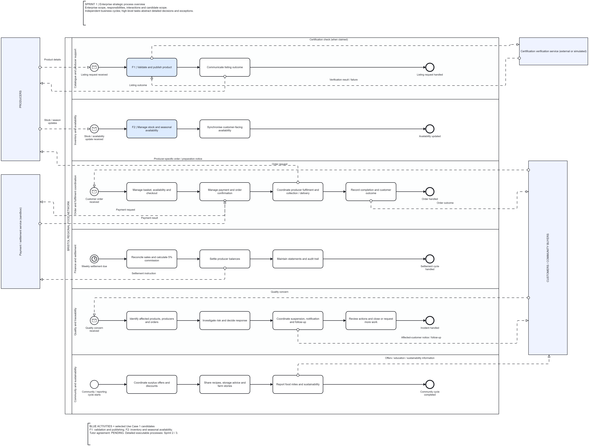

# Enterprise Strategic BPMN

| File | Purpose |
|---|---|
| [Strategic-BPMN.bpmn](Strategic-BPMN.bpmn) | Canonical BPMN 2.0 XML export from the saved Camunda baseline |
| [Strategic-BPMN.png](Strategic-BPMN.png) | Readable full-resolution export of the same baseline |

[Open the diagram in Camunda](https://hub.camunda.io/diagrams/0e4d3877-3211-460d-b58e-656a9d09e7f3--strategic-bpmn-bristol-food-network).

Saved model version: **Sprint 1 - Reviewed baseline 2026-10-28**.
Camunda Design reported **Problems 0** after the corrected upload.

The model contains six responsibility lanes, 18 high-level tasks, 24 sequence flows and 14 message flows. Four external participants surround the enterprise pool. Blue tasks identify candidate functions F1 and F2.

This is a non-executable strategic model. Read each lane as a separate business cycle. Detailed alternative paths, cross-process data/integration behaviour and executable configuration belong to later operational models. The reading guide and design assumptions are documented in the [Sprint 1 notes](../../docs/sprint-1/README.md).

For local viewing, open the `.bpmn` file in a compatible BPMN modeler. For Web Modeler work, use the existing diagram link. Downloading XML from GitHub does not update the cloud diagram; importing/replacing a cloud diagram is an explicit action. Keep the current version before replacing anything.

